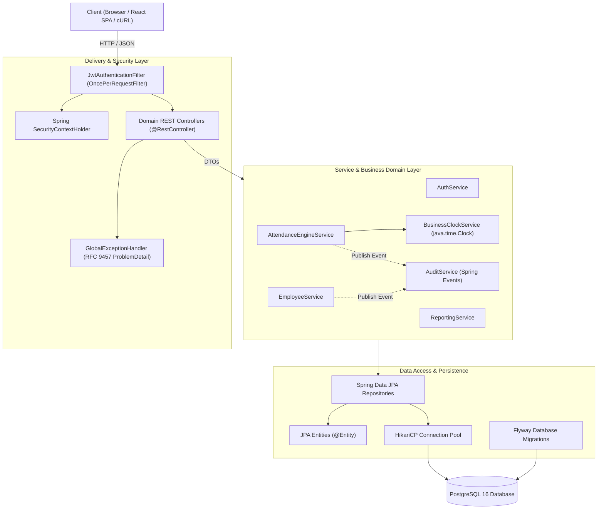

# Architectural Specification: Smart Attendance Platform

## 1. Architectural Style: Modular Layered Monolith
The backend adheres to Clean Architecture and Layered Monolith principles. The codebase is organized by business domain with clear separation between HTTP delivery, business logic, persistence, and cross-cutting concerns.



---

## 2. Package Structure & Responsibilities

```text
com.smartattendance.platform/
├── common/                 # Cross-cutting utilities and infrastructure
│   ├── config/             # ClockConfig, OpenApiConfig, JacksonConfig
│   ├── exception/          # Domain exceptions & RFC 9457 GlobalExceptionHandler
│   ├── model/              # BaseEntity, PageResponse, ApiResponse
│   └── util/               # CsvSanitizer, DateTimeUtils
├── security/               # Authentication and authorization
│   ├── config/             # SecurityFilterChain, CorsConfig, PasswordEncoder
│   ├── jwt/                # JwtTokenProvider, JwtAuthenticationFilter, JwtProperties
│   └── model/              # UserPrincipal, SecurityConstants
├── audit/                  # Audit trail and event publishing
│   ├── entity/             # AuditLog
│   ├── repository/         # AuditLogRepository
│   ├── service/            # AuditService, AuditEventListener
│   └── event/              # Domain events (EmployeeEvent, AttendanceEvent)
├── employee/               # Employee management domain
│   ├── entity/             # Employee, EmployeeRole, EmployeeStatus
│   ├── repository/         # EmployeeRepository
│   ├── service/            # EmployeeService
│   ├── controller/         # EmployeeController
│   └── dto/                # CreateEmployeeRequest, UpdateEmployeeRequest, EmployeeResponse
├── attendance/             # Core attendance business engine
│   ├── entity/             # AttendanceRecord, AttendanceStatus
│   ├── repository/         # AttendanceRepository
│   ├── service/            # AttendanceService, AttendanceValidationService
│   ├── controller/         # AttendanceController
│   └── dto/                # ClockInRequest, ClockOutRequest, AttendanceResponse
└── reporting/              # Aggregations and file export
    ├── service/            # ReportingService, CsvExportService
    ├── controller/         # ReportingController
    └── dto/                # DailyAttendanceSummary, EmployeeSummaryDto
```

---

## 3. Key Architectural Decisions (ADRs)

### ADR-01: Java 21 LTS & Spring Boot 3.3.x
- **Decision**: Target Java 21 with Spring Boot 3.3.x.
- **Rationale**: Enables modern language features such as Java Records (for immutable, concise DTOs), sealed classes/interfaces, pattern matching for error handling, and Virtual Threads (`spring.threads.virtual.enabled=true`) for high-concurrency throughput.

### ADR-02: DTOs & Entity Isolation
- **Decision**: JPA Entities are strictly prohibited from leaking into controllers or API responses. All API contracts use Java Records as DTOs.
- **Rationale**: Prevents accidental data exposure (e.g., password hashes, internal database IDs), avoids Jackson circular reference issues during serialization, prevents `LazyInitializationException` outside transactions, and protects against mass-assignment security vulnerabilities.

### ADR-03: Dual-Key Strategy (BIGINT PK + UUID Public ID)
- **Decision**: Use `BIGINT GENERATED ALWAYS AS IDENTITY` for internal foreign keys, table joins, and primary indexing; expose a random `UUID public_id` for external URL paths and client references.
- **Rationale**: Mitigates IDOR (Insecure Direct Object Reference) and sequential ID enumeration attacks while retaining high-performance B-Tree foreign key indexing and low storage overhead in PostgreSQL.

### ADR-04: Concurrency & Duplicate Clock-in Invariant
- **Decision**: In addition to application-level checks, duplicate clock-ins on the same calendar date are enforced via a database unique constraint: `CONSTRAINT uq_attendances_employee_date UNIQUE (employee_id, attendance_date)`.
- **Rationale**: Application-level checks (`existsBy...`) have a race window under high concurrency. The database unique constraint is the ultimate authority guaranteeing ACID consistency.

### ADR-05: Timezone Handling
- **Decision**: The database operates strictly in UTC (`TIMESTAMPTZ`). Conversion to the company's official business date occurs in a centralized service using a configured `ZoneId` (e.g., `ZoneId.of("Asia/Kolkata")`).
- **Rationale**: Standardizing storage in UTC prevents subtle daylight saving time (DST) calculation errors and makes cross-region reporting reliable.

### ADR-06: JWT Security Model
- **Decision**: Stateless bearer tokens signed using HMAC-SHA256 (via `jjwt` library). The token contains claims for subject (`public_id`), email, and roles (`EMPLOYEE`, `MANAGER`, `ADMIN`).
- **Rationale**: Stateless authentication eliminates server session storage requirements while enabling role-based endpoint protection via Spring Security's `@PreAuthorize` and `SecurityFilterChain`.

