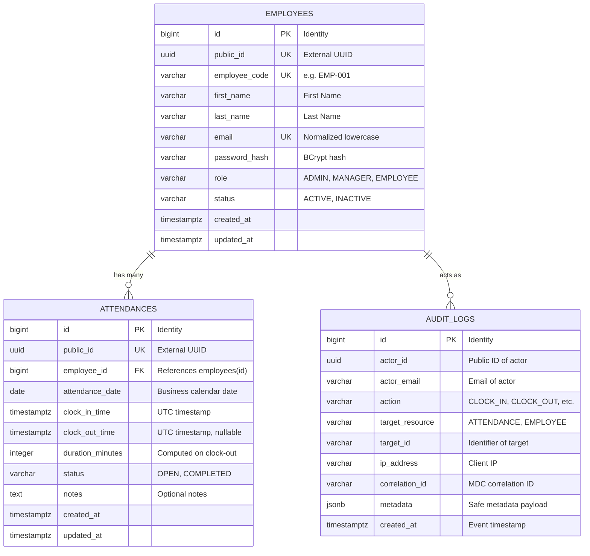

# Database Design & Persistence Specification

## 1. Relational Schema Diagram


---

## 2. PostgreSQL DDL & Constraints

### 2.1 Table: `employees`
```sql
CREATE TABLE employees (
    id BIGINT GENERATED ALWAYS AS IDENTITY PRIMARY KEY,
    public_id UUID NOT NULL DEFAULT gen_random_uuid(),
    employee_code VARCHAR(30) NOT NULL,
    first_name VARCHAR(100) NOT NULL,
    last_name VARCHAR(100) NOT NULL,
    email VARCHAR(255) NOT NULL,
    password_hash VARCHAR(255) NOT NULL,
    role VARCHAR(20) NOT NULL DEFAULT 'EMPLOYEE',
    status VARCHAR(20) NOT NULL DEFAULT 'ACTIVE',
    created_at TIMESTAMPTZ NOT NULL DEFAULT CURRENT_TIMESTAMP,
    updated_at TIMESTAMPTZ NOT NULL DEFAULT CURRENT_TIMESTAMP,
    CONSTRAINT uq_employees_public_id UNIQUE (public_id),
    CONSTRAINT uq_employees_code UNIQUE (employee_code),
    CONSTRAINT uq_employees_email UNIQUE (email),
    CONSTRAINT chk_employees_role CHECK (role IN ('ADMIN', 'MANAGER', 'EMPLOYEE')),
    CONSTRAINT chk_employees_status CHECK (status IN ('ACTIVE', 'INACTIVE'))
);

CREATE INDEX idx_employees_email ON employees(email);
CREATE INDEX idx_employees_code ON employees(employee_code);
CREATE INDEX idx_employees_public_id ON employees(public_id);
```

### 2.2 Table: `attendances`
```sql
CREATE TABLE attendances (
    id BIGINT GENERATED ALWAYS AS IDENTITY PRIMARY KEY,
    public_id UUID NOT NULL DEFAULT gen_random_uuid(),
    employee_id BIGINT NOT NULL REFERENCES employees(id) ON DELETE RESTRICT,
    attendance_date DATE NOT NULL,
    clock_in_time TIMESTAMPTZ NOT NULL,
    clock_out_time TIMESTAMPTZ,
    duration_minutes INTEGER,
    status VARCHAR(20) NOT NULL DEFAULT 'OPEN',
    notes TEXT,
    created_at TIMESTAMPTZ NOT NULL DEFAULT CURRENT_TIMESTAMP,
    updated_at TIMESTAMPTZ NOT NULL DEFAULT CURRENT_TIMESTAMP,
    CONSTRAINT uq_attendances_public_id UNIQUE (public_id),
    -- CRITICAL BUSINESS INVARIANT: Exactly one attendance record per employee per business date
    CONSTRAINT uq_attendances_employee_date UNIQUE (employee_id, attendance_date),
    CONSTRAINT chk_attendances_status CHECK (status IN ('OPEN', 'COMPLETED')),
    CONSTRAINT chk_clock_out_after_in CHECK (clock_out_time IS NULL OR clock_out_time >= clock_in_time)
);

CREATE INDEX idx_attendances_date_status ON attendances(attendance_date, status);
CREATE INDEX idx_attendances_employee_id ON attendances(employee_id);
CREATE INDEX idx_attendances_public_id ON attendances(public_id);
```

### 2.3 Table: `audit_logs`
```sql
CREATE TABLE audit_logs (
    id BIGINT GENERATED ALWAYS AS IDENTITY PRIMARY KEY,
    actor_id UUID,
    actor_email VARCHAR(255),
    action VARCHAR(50) NOT NULL,
    target_resource VARCHAR(50) NOT NULL,
    target_id VARCHAR(100),
    ip_address VARCHAR(45),
    correlation_id VARCHAR(64),
    metadata JSONB,
    created_at TIMESTAMPTZ NOT NULL DEFAULT CURRENT_TIMESTAMP
);

CREATE INDEX idx_audit_logs_created_at ON audit_logs(created_at DESC);
CREATE INDEX idx_audit_logs_actor_id ON audit_logs(actor_id);
```

---

## 3. Flyway Migration Plan
- `V1__init_employee_schema.sql`: Create `employees` table, constraints, and indexes.
- `V2__init_attendance_schema.sql`: Create `attendances` table, unique business date constraint, and indexes.
- `V3__init_audit_schema.sql`: Create `audit_logs` table and indexes.
- `V4__seed_development_data.sql`: Seed initial development accounts for local profiling (`admin@smartattendance.com`, `manager@smartattendance.com`, `employee@smartattendance.com`).

