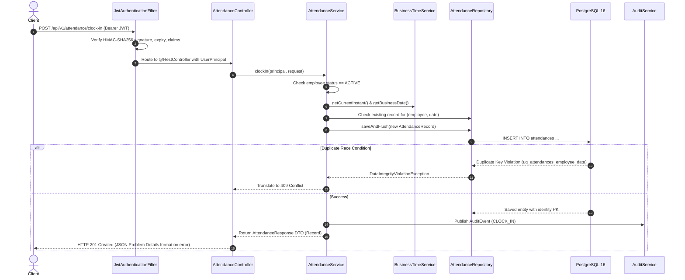

# Smart Attendance Platform — Senior Technical Interview Guide

This guide is designed to help you explain the architecture, business decisions, security mechanics, and database design of the **Smart Attendance Platform** during a technical interview.

---

## 1. Architectural Overview & Design Philosophy

The **Smart Attendance Platform** is structured as a **Modular Layered Monolith** built on **Clean Architecture** principles. Rather than an over-engineered distributed microservice cluster, it organizes distinct business capabilities (Employee Management, Attendance Engine, Reporting & CSV Analytics, Audit Trail) into clean, decoupled packages within a single deployable artifact.

### Core Architectural Decisions (ADRs)
1. **Java 21 LTS + Spring Boot 3.3.x**: Leverages Java Records for immutable DTOs, sealed hierarchies, and Virtual Threads capability for high-throughput I/O.
2. **DTO Layering**: JPA Entities never escape service boundaries. All incoming and outgoing payloads use strongly typed Java Records to prevent mass-assignment, circular serialization, and accidental leakage of sensitive attributes (e.g., password hashes).
3. **Dual-Key Strategy**: PostgreSQL uses high-performance `BIGINT GENERATED ALWAYS AS IDENTITY` primary keys for clustering and foreign key joins, while external HTTP APIs exclusively expose non-sequential cryptographically random `UUID` (`public_id`) values to eliminate IDOR and enumeration attacks.
4. **Timezone Standardization**: All internal timestamps are stored in UTC as PostgreSQL `TIMESTAMPTZ`. Corporate business days are derived in a centralized `BusinessTimeService` using an injectable `Clock` bean, ensuring test determinism and daylight saving immunity.
5. **Database-Level Invariant Enforcement**: Critical invariants (e.g., only one clock-in per employee per calendar date) are guaranteed at the database level with a `UNIQUE` constraint, preventing concurrency race conditions that application memory checks cannot prevent.

---

## 2. Request Lifecycle Walkthrough



---

## 3. How Concurrency and Duplicate Clock-Ins Are Prevented

### The Race Condition Window
In high-concurrency systems, if two requests arrive simultaneously:
1. Thread A executes `findByEmployeeAndAttendanceDate()` -> returns empty.
2. Thread B executes `findByEmployeeAndAttendanceDate()` -> returns empty.
3. Thread A executes `save()`.
4. Thread B executes `save()`.

Application-level `if (exists) throw DuplicateException` checks **cannot guarantee uniqueness** under concurrent execution.

### The Solution: Multi-Layered Protection
1. **Application Layer (Fast Path)**: Preliminary check for clean business validation and user feedback.
2. **Database Layer (Ultimate Authority)**:
   ```sql
   CONSTRAINT uq_attendances_employee_date UNIQUE (employee_id, attendance_date)
   ```
3. **Exception Translation Layer**: In `AttendanceService.java`, any `DataIntegrityViolationException` thrown by the persistence layer is caught and translated to a clean, RFC 9457 `409 Conflict` response with the exact error message:
   ```java
   try {
       return AttendanceResponse.from(attendanceRepository.saveAndFlush(record));
   } catch (DataIntegrityViolationException ex) {
       throw new DuplicateResourceException("Employee has already clocked in for this date.");
   }
   ```

---

## 4. 25 Likely Technical Interview Questions & Answers

### Architecture & Frameworks
#### Q1: Why did you choose a Modular Layered Monolith instead of Microservices?
> "For an attendance management system, business domains like Employee, Attendance, and Audit share transactional boundaries and benefit from ACID consistency. A modular monolith provides clean domain separation without the distributed transaction overhead, network latency, distributed tracing complexity, and operational cost of microservices."

#### Q2: Why did you choose Spring Boot 3.3 and Java 21?
> "Spring Boot 3 requires Java 17 minimum and is built on Spring Framework 6. Java 21 LTS brings Virtual Threads, Pattern Matching, and Records for concise DTOs. Spring Boot 3.3 also introduces native RFC 9457 `ProblemDetail` support and improved Actuator observability."

#### Q3: Why is Flyway used instead of `spring.jpa.hibernate.ddl-auto=update`?
> "In production, `ddl-auto=update` is non-deterministic and can cause accidental data loss or lock production tables. Flyway provides version-controlled, immutable, reproducible SQL migrations (`V1__...`, `V2__...`) that run automatically at application boot, ensuring all environments have the exact same schema."

#### Q4: Why use HikariCP and how is it tuned?
> "HikariCP is the default high-performance connection pool in Spring Boot. In `application.yml`, we configured `maximum-pool-size: 15`, `minimum-idle: 5`, and a connection timeout of 20 seconds. This avoids exhausting PostgreSQL backend process limits while maintaining sufficient throughput."

### Database & Persistence
#### Q5: Explain your dual-key primary key design.
> "We use `BIGINT GENERATED ALWAYS AS IDENTITY` for the internal primary key (`id`), which ensures optimal B-Tree clustering, indexing performance, and 8-byte foreign key storage. For external REST exposure, we use `UUID public_id` (`DEFAULT gen_random_uuid()`). This prevents Insecure Direct Object References (IDOR) and sequential enumeration attacks."

#### Q6: How do you prevent N+1 query problems in JPA?
> "In `AttendanceRepository.java`, all relational queries utilize explicit `JOIN FETCH a.employee` in JPQL. This forces Hibernate to issue a single SQL `INNER JOIN` rather than issuing 1 query for attendances and N subsequent queries for each associated employee."

#### Q7: Why use `TIMESTAMPTZ` in PostgreSQL?
> "`TIMESTAMPTZ` stores instants in UTC while respecting time offsets. Standardizing all database timestamps to UTC avoids Daylight Saving Time (DST) edge cases and ensures server location independence."

### Security & Authentication
#### Q8: How does JWT authentication work in this application?
> "Authentication is stateless using `io.jsonwebtoken` (JJWT 0.12). When a user posts valid credentials to `/api/v1/auth/login`, the server issues a signed JWT containing claims for `sub` (public UUID), `email`, `role`, and `code`. On subsequent requests, `JwtAuthenticationFilter` validates the signature using an HMAC-SHA256 secret key, verifies expiration, and populates Spring's `SecurityContextHolder`."

#### Q9: How are passwords secured?
> "Passwords are never stored in plaintext. We configure a `BCryptPasswordEncoder(12)` bean. BCrypt includes a cryptographic salt and 12 work factor rounds (4096 iterations), making brute-force and rainbow table attacks computationally infeasible."

#### Q10: How is cross-employee access prevented?
> "Role checks alone are not enough; an employee must not view another employee's records simply by changing the UUID in the URL. We enforce ownership validation at both the method security level (`@PreAuthorize("hasAnyRole('ADMIN', 'MANAGER') or authentication.principal.publicId == #id")`) and inside service logic."

#### Q11: Where should JWTs be stored on the frontend?
> "JWTs should never be stored in `localStorage` due to Cross-Site Scripting (XSS) risks. In production, the optimal approach is an `HttpOnly`, `Secure`, `SameSite=Strict` cookie with CSRF tokens. In our SPA implementation, tokens are kept in memory and sessionStorage for page refresh resilience."

### Core Business Logic
#### Q12: How are attendance durations calculated?
> "Duration is calculated exclusively on the server using `Duration.between(openRecord.getClockInTime(), clockOutTime).toMinutes()`. Client-provided timestamps or durations are never trusted."

#### Q13: How does the application handle overnight shifts?
> "The business date is calculated when the employee clocks in. If an employee clocks in at 23:00 on October 28 and clocks out at 07:00 on October 29, the attendance record remains associated with the business date `2026-10-28`. Duration is computed from the actual UTC instants."

#### Q14: Why inject `java.time.Clock` instead of calling `Instant.now()` directly?
> "Calling static `Instant.now()` makes time-dependent logic impossible to test deterministically. By injecting a `Clock` bean (or `BusinessTimeService`), unit tests can pass a fixed clock (`Clock.fixed(...)`) and test midnight boundaries, duration calculations, and timezone offsets with 100% precision."

### Reporting & API Quality
#### Q15: What is CSV Formula Injection and how is it mitigated?
> "CSV Formula Injection occurs when spreadsheet applications (Excel, Google Sheets) execute cells starting with `=`, `+`, `-`, or `@` as executable formulas. In `CsvSanitizer.java`, we inspect the first character of each string and prepend a single quote `'` to neutralize formula execution."

#### Q16: What is RFC 9457 Problem Details?
> "RFC 9457 is the modern IETF standard for HTTP API error responses. Instead of inconsistent custom JSON maps, all exceptions return `type`, `title`, `status`, `detail`, `instance`, `timestamp`, and `correlationId`."

#### Q17: What is the purpose of the Correlation ID?
> "`CorrelationIdFilter` inspects incoming `X-Correlation-Id` headers (or generates a new UUID) and places it into SLF4J MDC (Mapped Diagnostic Context). This correlation ID is logged across every message in that request thread and returned in error responses, enabling instant end-to-end trace correlation."

### Testing & Reliability
#### Q18: What is your testing pyramid strategy?
> "We combine unit tests for pure domain logic (`EmployeeServiceTest`, `AttendanceServiceTest` using Mockito and mock clocks) with integration tests (`EmployeeControllerTest`, `AttendanceControllerTest`, `ReportingControllerTest` using `MockMvc` and real web contexts)."

#### Q19: Why was H2 used for the test profile alongside PostgreSQL Flyway migrations?
> "H2 in PostgreSQL compatibility mode allows blazing fast, zero-dependency unit and controller slice testing without requiring a live Docker daemon on every developer machine. In CI and staging, PostgreSQL is run via Docker Compose / Testcontainers for production parity."

#### Q20: How does the system handle inactive employees?
> "When an employee is deactivated (`EmployeeStatus.INACTIVE`), their `UserPrincipal.isEnabled()` returns `false`, which immediately prevents login. If an inactive user attempts attendance operations, `AttendanceService` checks `employee.getStatus()` and throws an `AccessDeniedException`."

#### Q21: Why are Java Records used for DTOs?
> "Records provide immutable data carriers with built-in `equals`, `hashCode`, `toString`, and transparent accessor methods. They prevent accidental mutation of API payloads and serialize cleanly with Jackson."

#### Q22: How is pagination implemented efficiently?
> "Endpoints accept Spring Data `Pageable` parameters (`page`, `size`, `sort`). The repository executes a `LIMIT` / `OFFSET` query combined with a count query, returning a `PageResponse<T>` record with content, totalElements, and totalPages."

#### Q23: How does audit logging work without degrading attendance performance?
> "We use Spring's `ApplicationEventPublisher`. When an employee or attendance action succeeds, an `AuditEvent` is published. `AuditService` listens with `@EventListener` and saves the event to the `audit_logs` table in a new transaction (`Propagation.REQUIRES_NEW`), ensuring the audit log is decoupled from the business service."

#### Q24: What health checks exist in the system?
> "Spring Boot Actuator exposes `/actuator/health`. We implemented a custom `DatabaseHealthIndicator` that executes `SELECT 1` through HikariCP to verify database connectivity."

#### Q25: How do you document API endpoints?
> "We use `springdoc-openapi` (OpenAPI 3.0). It inspects Spring MVC controllers and annotations (`@Operation`, `@ApiResponse`, `@Tag`) and exposes interactive documentation at `/swagger-ui/index.html` with full JWT Bearer authorization support."

---

## 5. Five Realistic Bugs & How the System Handles Them

| Scenario | Potential Risk | Architectural Safeguard |
| :--- | :--- | :--- |
| **Simultaneous Clock-In Requests** | Two mobile app taps or network retries create two open sessions for the same day. | The database `UNIQUE(employee_id, attendance_date)` constraint causes the second insert to fail with a unique key violation, caught and translated to HTTP 409 Conflict. |
| **Clock-Out Before Clock-In** | System clock jump or corrupt request causes negative work duration. | `AttendanceService` verifies `clockOutTime >= clockInTime` and throws `InvalidOperationException` if violated. Database check constraint `chk_clock_out_after_in` enforces this at persistence. |
| **Spreadsheet Formula Exploit in Notes** | Attacker inputs `=cmd|'/C calc'!A0` in attendance notes. An admin opening the CSV export executes malicious code. | `CsvSanitizer` scans all string cells and prepends a single quote `'` to any cell starting with `=`, `+`, `-`, or `@`. |
| **Enumerating Employee IDs** | Attacker iterates through sequential IDs (`/employees/1`, `/employees/2`) to scrape employee details. | External endpoints accept random `UUID` public IDs (`550e8400-e29b-41d4-a716-446655440000`). Database sequential primary keys are never exposed. |
| **Clocking Out Without an Open Shift** | Client sends clock-out request when no active session exists or session was already completed. | `AttendanceRepository.findByEmployeeIdAndStatus(id, OPEN)` returns empty, triggering a clean HTTP 400 Bad Request error. |

---

## 6. Limitations and Future Enhancements
1. **Biometric & Geofencing Verification**: Future versions can store GPS latitude/longitude or IP geofence boundaries to restrict clock-ins to corporate premises.
2. **Leave Management Integration**: Integration with a PTO/Holiday calendar to automatically flag absences and public holidays.
3. **Overtime Rules Engine**: Customizable daily/weekly overtime threshold multipliers (e.g., >8 hours/day = 1.5x rate).

